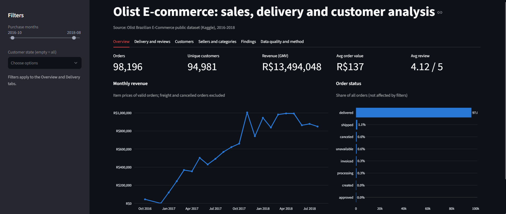
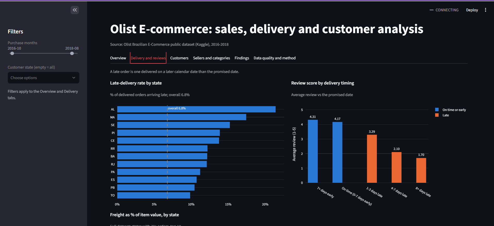
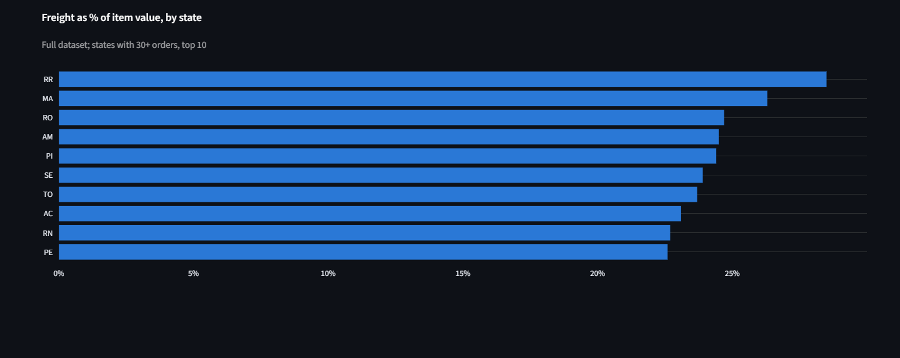
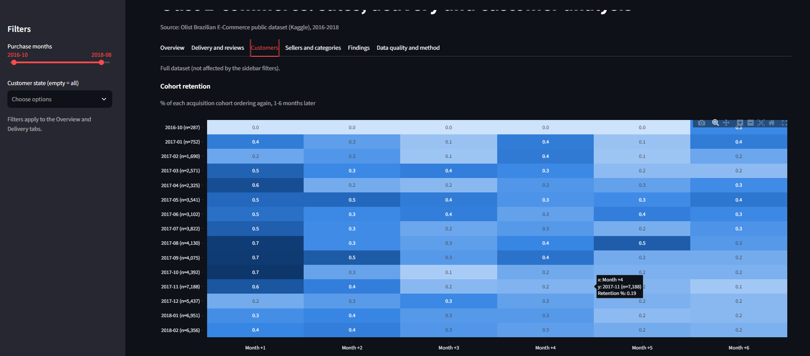
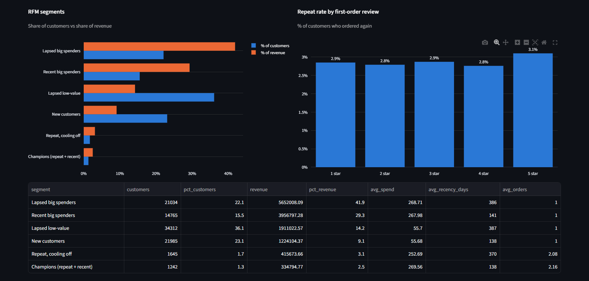
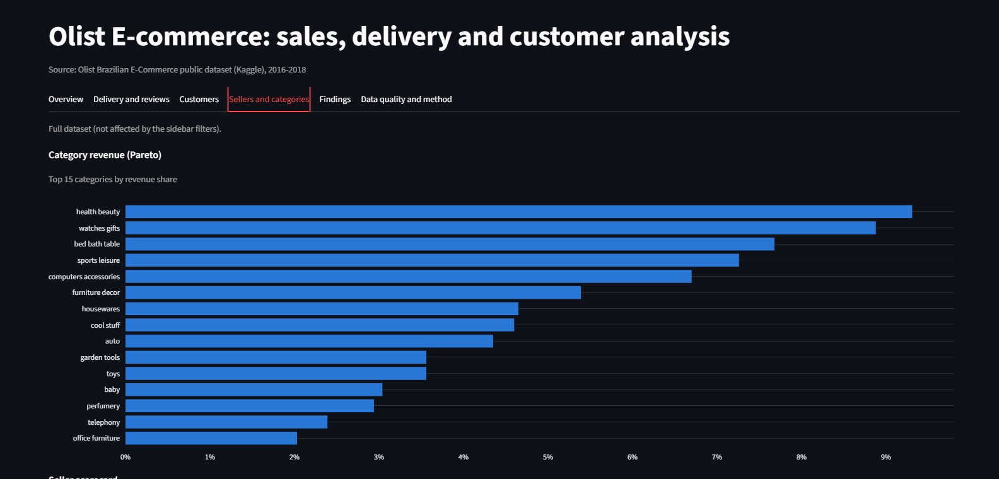
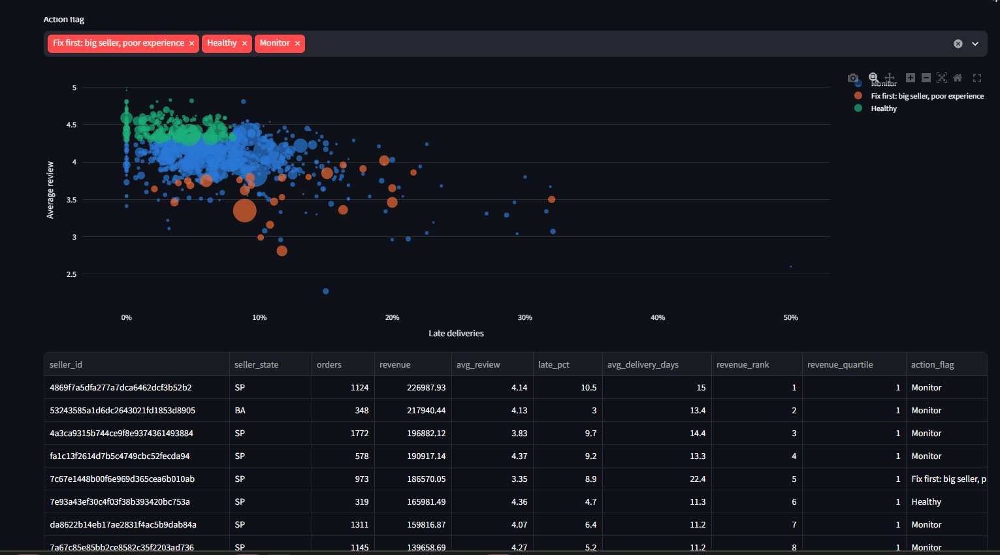

# Olist E-commerce Analytics: delivery, customers and sellers
**Live dashboard:** [olist-ecommerce-analytics.streamlit.app](https://olist-ecommerce-analytics-dajdftqwpc6crghj22dfcl.streamlit.app/)**
An end-to-end data analyst project on the Brazilian Olist marketplace (about 100k orders, 2016-2018). It answers one business question: **where is the marketplace losing customers and money, and what should be fixed first?**

## Key findings (real Olist data, 98,199 valid orders, R$13.5M GMV)

- **Late delivery is strongly associated with unhappy customers.** Late orders average 2.27 stars vs 4.29 on time (gap 2.02, 95% CI [1.98, 2.06]). For orders 8+ days late, 79% of reviews are 1-2 stars vs 9% for on-time orders.
- **Delivery problems are local, not national.** The late rate is 6.8% overall but 21.4% in Alagoas (AL); orders there arrive 8.7 days *early* on average, so the issue is the late tail, not the average estimate.
- **Revenue is concentrated.** 18 of 74 categories make 80% of revenue.
- **Retention is structurally low.** Only 3.0% of customers order twice, and a bad first review does not change that (2.8% vs 3.0% repeat, 95% CI of the difference [-0.1, 0.5] includes zero). I tested this idea and it was not supported, so the recommendation is an A/B test of a second-purchase incentive, not a service fix.
- **Lapsed big spenders** are 22% of customers but 42% of revenue: the best win-back target.
- **27 of 804 scored sellers** are top-quartile revenue with poor reviews or late delivery (7% of scored seller revenue).

Full results and sized recommendations: `outputs/findings.md`.

**Live dashboard:** _add your Streamlit link here_

## Dashboard preview

Interactive Streamlit dashboard with sidebar filters (purchase months, customer state) on the Overview and Delivery tabs.

**Overview**: KPIs, monthly revenue and order status mix


**Delivery and reviews**: late-delivery rate by state, and review score by delivery timing




**Customers**: cohort retention heatmap


RFM segments, and repeat rate by first-order review (no meaningful difference between 1 and 5 stars)


**Sellers and categories**: category revenue (Pareto) and the seller scorecard




## Business questions and SQL techniques

| # | Question | Technique | File |
|---|----------|-----------|------|
| 1 | What are the headline KPIs (GMV, AOV, late rate, review score)? | aggregates, views | `01_kpi_summary.sql` |
| 2 | How is revenue growing month to month? | `LAG`, growth % | `02_monthly_revenue_growth.sql` |
| 3 | Which categories drive 80% of revenue? | Pareto, cumulative `SUM() OVER` | `03_category_pareto.sql` |
| 4 | Which states have delivery problems? | late rate vs promise | `04_delivery_by_state.sql` |
| 5 | Do late deliveries hurt reviews? | bucketing, CASE | `05_late_delivery_vs_reviews.sql` |
| 6 | Do customers come back? | first-purchase cohorts, month offsets | `06_cohort_retention.sql` |
| 7 | Who are our best and lapsed customers? | RFM with `NTILE` | `07_rfm_segments.sql` |
| 8 | Which sellers are high revenue but high risk? | scorecard, quartiles | `08_seller_scorecard.sql` |
| 9 | How do customers pay? | payment mix | `09_payment_mix.sql` |
| 10 | Where do orders drop out? | status funnel | `10_order_status_funnel.sql` |
| 11 | Where is freight a heavy burden? | freight / item value | `11_freight_burden_by_state.sql` |
| 12 | Does a bad first order reduce repeat purchase? | cohort comparison + CI | `12_first_order_experience_vs_repeat.sql` |

Metric definitions (valid order, revenue, late order, review score) are documented at the top of `sql/00_views.sql`. Two choices worth defending in an interview:
- **Late** compares calendar dates, not timestamps, because the estimate is stored as midnight of the promised day. Raw timestamps would wrongly flag same-day deliveries.
- **One review per order**: the latest by answer timestamp, because some orders have duplicates.

## Project layout

```
data/raw/            Olist CSVs (not committed)
sql/00_views.sql     order_facts and item_facts views
sql/queries/         12 analysis queries, each with its business question
src/load_db.py       CSV -> SQLite, plus 8 data-quality checks
src/run_analysis.py  runs the queries, draws charts, writes outputs/findings.md
dashboard/app.py     Streamlit dashboard (reads only outputs/)
docs/screenshots/    dashboard screenshots used in this README
outputs/             CSV results, figures, findings.md, data_quality.csv
```

## Run it yourself

1. Download **Brazilian E-Commerce Public Dataset by Olist** from Kaggle: https://www.kaggle.com/datasets/olistbr/brazilian-ecommerce
2. Create `data/raw/` and unzip the 9 CSVs into it, keeping the original file names.
3. Run:

```bash
pip install -r requirements.txt
python src/load_db.py        # loads SQLite, prints data-quality checks
python src/run_analysis.py   # results, charts, findings.md
streamlit run dashboard/app.py
```

`run_analysis.py` detects the real data automatically and removes the sample warning from charts and findings. Then read `outputs/findings.md`: the figures, recommendations and resume bullet are regenerated from your real numbers.

## Deploy the dashboard (free)

1. Push the repo to GitHub (raw data and the database are git-ignored; `outputs/` is committed so the dashboard needs no raw data).
2. On https://share.streamlit.io choose the repo, main file `dashboard/app.py`.
3. Put the live link at the top of this README.

## What to say in an interview

- **Framing:** "I started from a business question, not a dataset."
- **Rigor:** data-quality checks, metric definitions, confidence intervals on the review and repeat-purchase gaps, and a caveats section (association, not causation; non-response bias).
- **Recommendations are sized**, not just described (see `outputs/findings.md`).
- **Likely follow-ups:** why latest review per order? why compare dates not timestamps? how would you test whether late delivery *causes* lower repeat rate? (Answer: A/B test a better delivery promise, or compare similar orders with a matching or regression approach.)

## Limitations

Observational data; review scores exist only for customers who responded; retention near the end of the data window is incomplete; revenue excludes freight and cancelled orders.
